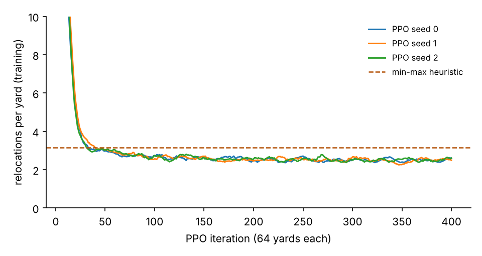

# Container Yard Stacking with Reinforcement Learning (PPO in NumPy)

When a container has to leave but others are stacked on top of it, a crane must move those containers first. Each extra move is a **relocation** (a "rehandle"), and it costs crane time at every container terminal. Given the planned departure order, **which stack should each arriving container go on?**

This repo builds a simulator for that problem, four stacking policies, an exact solver for tiny yards, and **PPO written from scratch in NumPy** (no deep-learning library), then tests all of them on unseen yards.



## The problem
- A yard bay has `S` stacks, each at most `H` containers high (last in, first out).
- `N` containers arrive one at a time; each has a known departure rank (0 leaves first).
- After all have arrived they leave in rank order. Every container above the one being pulled is relocated by one fixed rule, the same for every policy, so policies differ **only in where they place arrivals**.
- Cost = total relocations. The learner gets this as a single reward at the end (minus the relocations), so it must work out which early placements caused later moves.

## Key results
Main yard: 6 stacks x 5 high, 24 containers (80% full), 1,000 unseen random yards. PPO was trained 3 times with different seeds.

| Policy | Relocations per yard (95% CI) |
|---|---|
| Random | 17.63 (17.39 to 17.88) |
| Lowest stack (spread the load) | 17.68 (17.46 to 17.91) |
| Min-max heuristic (classic rule) | 3.15 (2.97 to 3.33) |
| **PPO** (3 seeds) | **2.46, 2.26, 2.29** (mean 2.34, about 26% below the heuristic) |

| Test | Finding |
|---|---|
| Paired vs the heuristic | In every seed PPO had fewer relocations than the heuristic on 39% to 43% of yards, the same on 40% to 46% and more on 14% to 21%. The mean gain is 0.69 to 0.89 relocations per yard; the 95% intervals (-0.82 to -0.56, -1.02 to -0.77, -0.99 to -0.75) all exclude zero. |
| Exact optimum (tiny yards: 3 stacks x 4 high, 9 containers, 60 yards) | Optimum 1.27 relocations. Heuristic 2.10 (optimal on 33 of 60 yards). PPO 1.50 to 1.53 (optimal on 46 to 48 yards), about 70% of the heuristic's gap to the optimum closed. |
| Other yard sizes, no retraining | The same policy beats the heuristic on 4x4 (1.14 vs 1.40), 8x6 (2.46 vs 2.67) and 10x6 (2.72 vs 2.87). The gains are smaller than on the training size. |
| Noisy departure plans | When the policies see ranks with noise (std 5% to 40% of N) while true ranks decide the cost, **everyone gets worse fast**: at 10% noise PPO 5.07 vs heuristic 5.99; at 40% PPO 12.25 vs 12.38, no real edge. |

The three seeds are consistent, but the 95% intervals only cover test-yard sampling, not seed-to-seed spread, so judge the size of the gain by the three seed values above.

## How it works
- **Policy:** one small network scores each candidate stack from 7 features (height, empty, how many containers below leave earlier than the new one, the gap to the top's departure, the new container's rank, yard fill). A masked softmax over stacks with room picks the stack. The same network scores any number of stacks, which is why one trained policy runs on yards of other sizes.
- **Value function:** a second network on pooled yard features. With one final reward and no discounting, the advantage at each step is the final reward minus this value estimate.
- **PPO:** clipped objective (0.2), entropy bonus (0.01), Adam, 4 epochs, 64 yards per iteration, 400 iterations (about 30 s on a laptop). Gradients are written by hand in `yard/ppo.py`.
- **Min-max heuristic:** place the container on the stack whose earliest-leaving container leaves just after it, otherwise on an empty stack, otherwise where the damage is smallest.
- **Exact solver:** tries every legal placement sequence (empty stacks are interchangeable) and keeps the fewest relocations.

## Structure
```
yard/env.py        yard simulator, relocation rule, departure cost
yard/policies.py   random, lowest-stack, min-max heuristic
yard/ppo.py        PPO and the two small networks in NumPy
yard/exact.py      exact optimum for tiny yards
tests/test_env.py  hand-checked cases for the simulator
run.py             reproduces every number above and the plot
results/           results.json, training_curve.png
```

## Run
```bash
pip install numpy matplotlib
python tests/test_env.py
python run.py        # about 2 minutes
```

## Limits
- Departure ranks are assumed known. Real plans are uncertain, and the noise test shows the learned edge disappears when they are very wrong; a real system needs a model of that uncertainty.
- One bay and one fixed relocation rule. Real terminals add crane travel, several bays, truck and vessel timing, and mixed container types.
- The yards are random permutations. Real arrival and departure patterns are not uniform, so a policy should be retrained on real plans.
- The heuristic is one classic rule, not the best known method. PPO beating it shows the learner works, not that it beats an optimisation solver.
- Training is cheap, but only three seeds were run.
